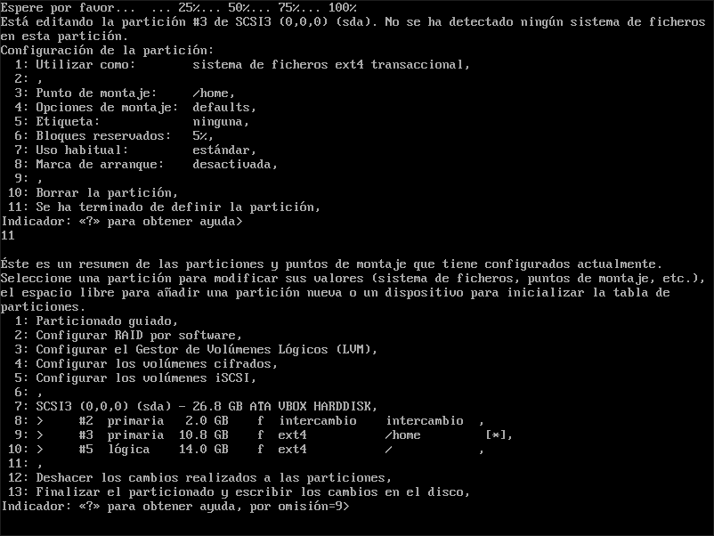
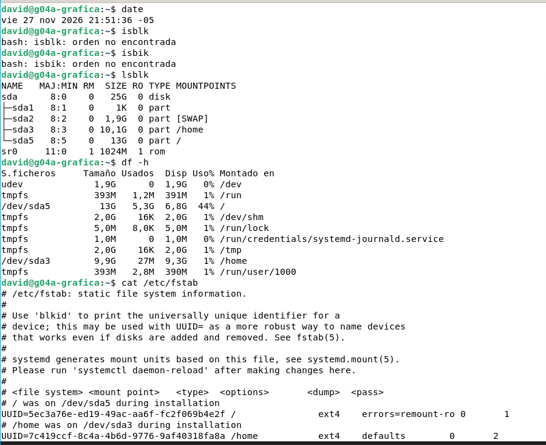
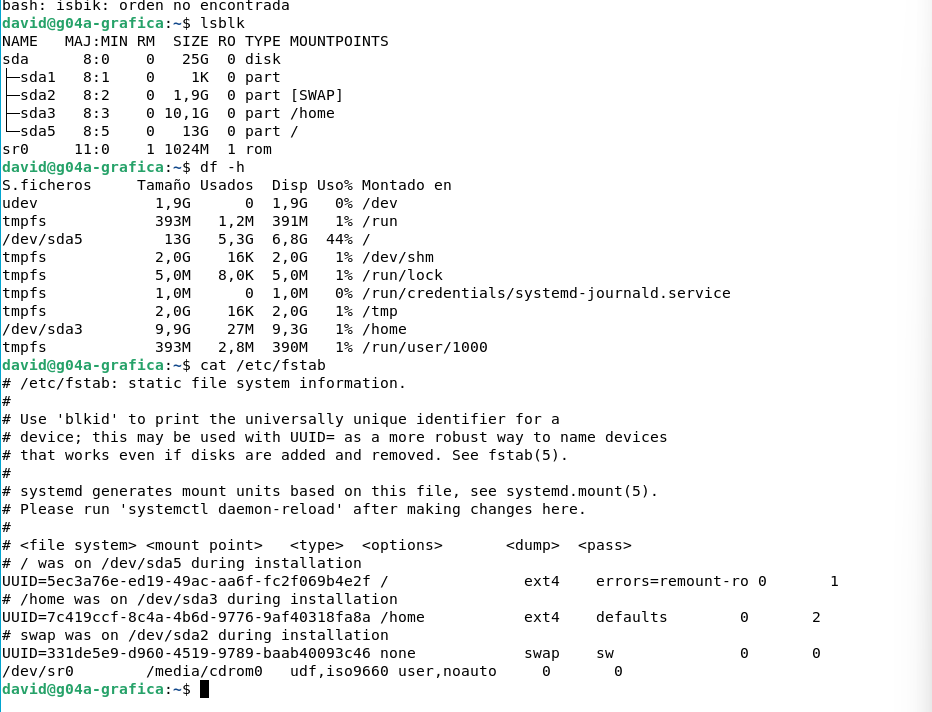
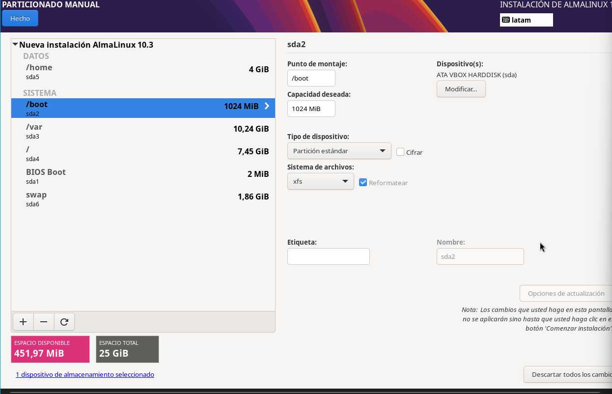
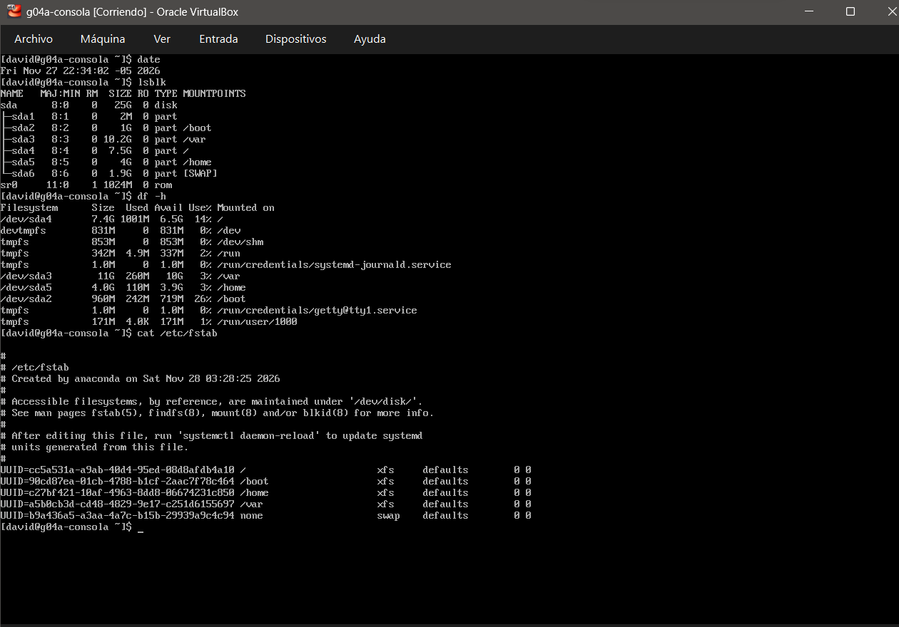
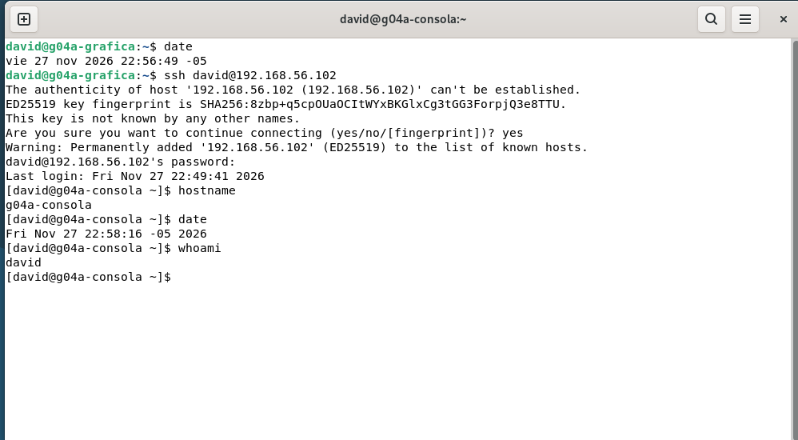

# Sprint 1 - Montaje

## Grupo 04A - Sistemas Operativos

Durante este sprint realizamos la instalación y configuración de dos máquinas virtuales en Oracle VirtualBox, utilizando Debian como sistema gráfico y AlmaLinux como sistema de consola. También configuramos la red y comprobamos la comunicación mediante ping y SSH.

## 1. VM gráfica (g04a-grafica)

Instalamos Debian 13.8 con entorno de escritorio GNOME, realizando el particionado manual del disco virtual de 25 GiB.

| Partición | Tamaño | Sistema de archivos | Justificación |
|---|---|---|---|
| / | 14 GB | ext4 | Almacenar el sistema operativo, aplicaciones y actualizaciones. |
| swap | 2 GB | swap | Apoyar la memoria RAM cuando sea necesario. |
| /home | 10.8 GB | ext4 | Almacenar los archivos personales de forma independiente del sistema. |

### Particionado manual

### Verificación de particiones

Comandos utilizados:

- `date`
- `lsblk`
- `df -h`
- `cat /etc/fstab`

Los resultados permiten comprobar la distribución del disco, los puntos de montaje y la configuración de las particiones.

### Navegadores y editores

Instalamos y verificamos los siguientes programas:

| Programa | Tipo | Versión |
|---|---|---|
| Firefox ESR | Navegador | 153.8.0 |
| Chromium | Navegador | 156.0.8078.114 |
| Nano | Editor de texto | 8.4 |
| GNOME Text Editor | Editor de texto | 48.3 |

Comandos utilizados:

- `firefox-esr --version`
- `chromium --version`
- `nano --version`
- `gnome-text-editor --version`

## 2. VM de consola (g04a-consola)

Instalamos AlmaLinux 10.3 en su versión mínima, sin entorno de escritorio gráfico, con 2 CPU, 2 GiB de RAM y un disco virtual de 25 GiB.

### Particionado manual

| Partición | Tamaño | Sistema de archivos | Justificación |
|---|---|---|---|
| / | 7.45 GiB | XFS | Almacenar el sistema operativo y sus herramientas. |
| /var | 10.24 GiB | XFS | Reservar espacio para registros, servicios y futuras imágenes de Docker. |
| swap | 1.86 GiB | swap | Apoyar la memoria RAM. |
| /home | 4 GiB | XFS | Almacenar archivos y configuraciones del usuario. |
| /boot | 1 GiB | XFS | Almacenar el kernel y los archivos de arranque. |
| BIOS Boot | 2 MiB | No aplica | Permitir el arranque mediante BIOS en un disco GPT. |

### Verificación de particiones

Comandos utilizados:

- `date`
- `lsblk`
- `df -h`
- `cat /etc/fstab`

Se comprobó que las particiones fueron creadas correctamente y que los sistemas de archivos se encuentran montados.

### Instalación de herramientas

Comando utilizado:

`sudo dnf install make rsync curl git wget -y`

| Herramienta | Versión | Función |
|---|---|---|
| Make | 4.4.1 | Automatización de compilaciones. |
| Rsync | 3.5.0 | Sincronización de archivos. |
| Curl | 8.12.1 | Transferencia de datos. |
| Git | 2.52.0 | Control de versiones. |
| Wget | 1.24.5 | Descarga de archivos. |

Comandos de verificación:

- `make --version`
- `rsync --version`
- `curl --version`
- `git --version`
- `wget --version`

## 3. Configuración de red

Configuramos dos adaptadores de red en cada máquina virtual.

| Adaptador | Modo | Función |
|---|---|---|
| Adaptador 1 | NAT | Acceso a internet. |
| Adaptador 2 | Solo anfitrión | Comunicación entre las máquinas virtuales. |

### Direcciones IP

| Máquina virtual | NAT | Solo anfitrión |
|---|---|---|
| Debian | 10.0.2.15 | 192.168.56.101 |
| AlmaLinux | 10.0.2.15 | 192.168.56.102 |

Comandos utilizados:

- `date`
- `ip a`

La evidencia de las direcciones IP de AlmaLinux está pendiente de incorporarse al repositorio.

### Comunicación desde Debian hacia AlmaLinux

Comando:

`ping -c 4 192.168.56.102`

### Comunicación desde AlmaLinux hacia Debian

Comando:

`ping -c 4 192.168.56.101`

Las pruebas de comunicación fueron exitosas en ambos sentidos, con cuatro paquetes enviados, cuatro recibidos y un 0 % de pérdida.

### Verificación de internet

Comando utilizado en Debian:

`ping -c 4 deb.debian.org`

Se comprobó el acceso a internet y la comunicación con AlmaLinux.

### Solución de problemas de red

Durante la configuración de Debian encontramos que un mismo perfil de NetworkManager estaba siendo utilizado por las dos interfaces, lo que impedía mantener ambas conexiones activas simultáneamente.

Creamos un perfil independiente para NAT mediante los comandos:

`sudo nmcli connection add type ethernet ifname enp0s3 con-name NAT ipv4.method auto`

`sudo nmcli connection up NAT`

Después verificamos que ambas interfaces tuvieran una dirección IP y realizamos nuevamente las pruebas de conectividad.

## 4. Conexión SSH

Instalamos y habilitamos el servidor OpenSSH en AlmaLinux.

Comandos utilizados:

- `sudo dnf install openssh-server -y`
- `sudo systemctl enable --now sshd`
- `sudo systemctl status sshd`

Desde Debian realizamos la conexión remota:

`ssh david@192.168.56.102`

Una vez iniciada la sesión, ejecutamos:

- `hostname`
- `date`
- `whoami`

La conexión fue exitosa. Desde la máquina gráfica Debian conseguimos acceder remotamente a AlmaLinux utilizando el usuario david.

## 5. Instantáneas

Se debe crear una instantánea por cada máquina virtual, denominada `instalacion-limpia`, con el sistema operativo apagado.

Estado: pendiente de realizar.

## 6. Código de verificación del Sprint 1

Estado: pendiente de localizar el código publicado por el docente en el campus virtual.

El código deberá guardarse en el archivo `codigo_sprint1.txt` en el directorio personal del usuario principal de ambas máquinas virtuales.

## 7. Video del sprint

Duración máxima: 3 minutos.

Estado: pendiente de incorporar el enlace del video de YouTube.

## 8. Lo que hizo cada integrante en este sprint

| Integrante | Qué hizo | Commits |
|---|---|---|
| Isaí | Creó las páginas del sitio y revisó la ficha | 2 |
| Andres | Instaló y configuró las dos VMs, la red, SSH y las instantáneas y subió las capturas al sitio | 3 |
| Isaí | Instaló las herramientas en la consola, grabó el video |

## 9. Resultados del sprint

Se completó la instalación de Debian y AlmaLinux, se verificaron sus particiones y herramientas, y se consiguió establecer comunicación entre ambos sistemas mediante ping y SSH.

Quedan pendientes las instantáneas, el código de verificación y la incorporación del video.
